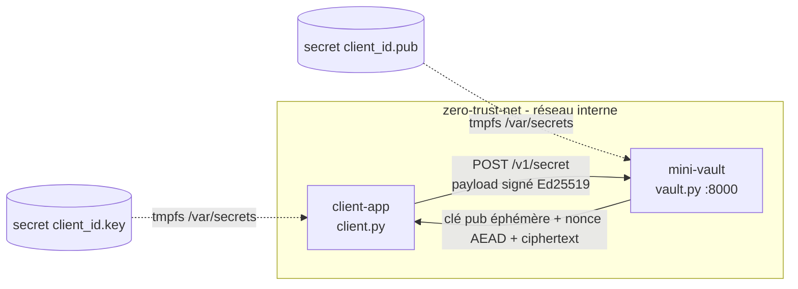
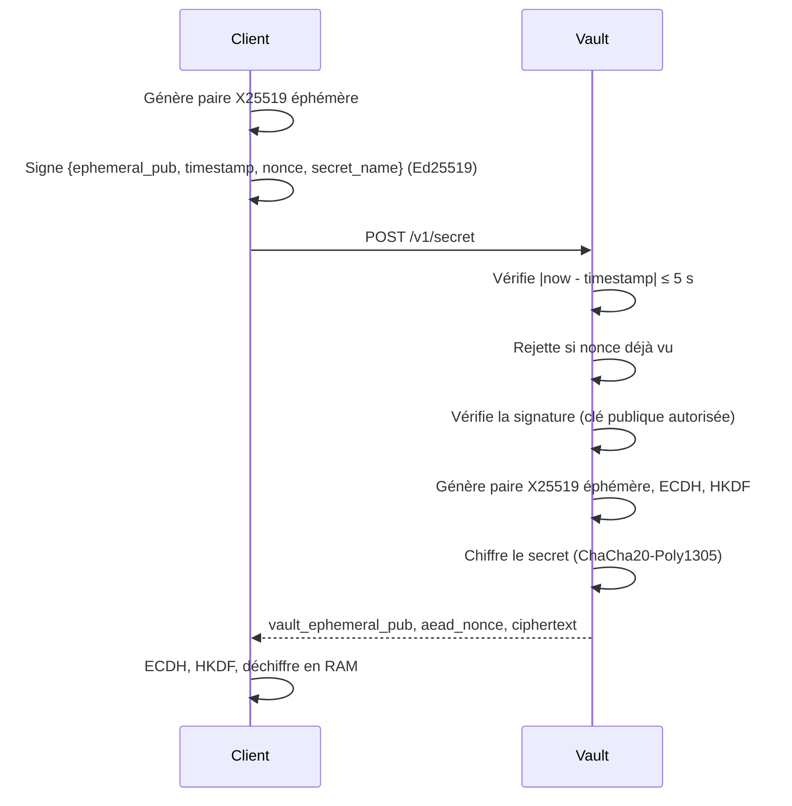

# Lab Zero-Trust Vault

Mini-Vault FastAPI : authentification Ed25519, anti-rejeu (timestamp + nonce), échange X25519 éphémère (ECIES) avec HKDF-SHA256 et ChaCha20-Poly1305.

## Architecture

## Protocole

## Utilisation

- Tout-en-un : `./setup.sh` (génère les clés, test local, puis Docker BuildKit)
- Local sans Docker : `python3 standalone_debug.py`
- Deux terminaux (breakpoints IDE) :
  - `CLIENT_PUB_KEY_PATH=./certs/client_id.pub uvicorn vault:app --host 127.0.0.1 --port 8000 --reload`
  - `CLIENT_PRIV_KEY_PATH=./certs/client_id.key VAULT_URL=http://127.0.0.1:8000/v1/secret python3 client.py`

Lab uniquement : secrets et nonces en mémoire, clés en `chmod 644`.
