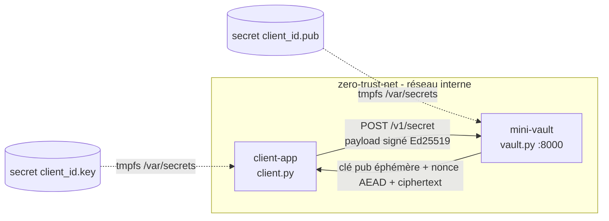
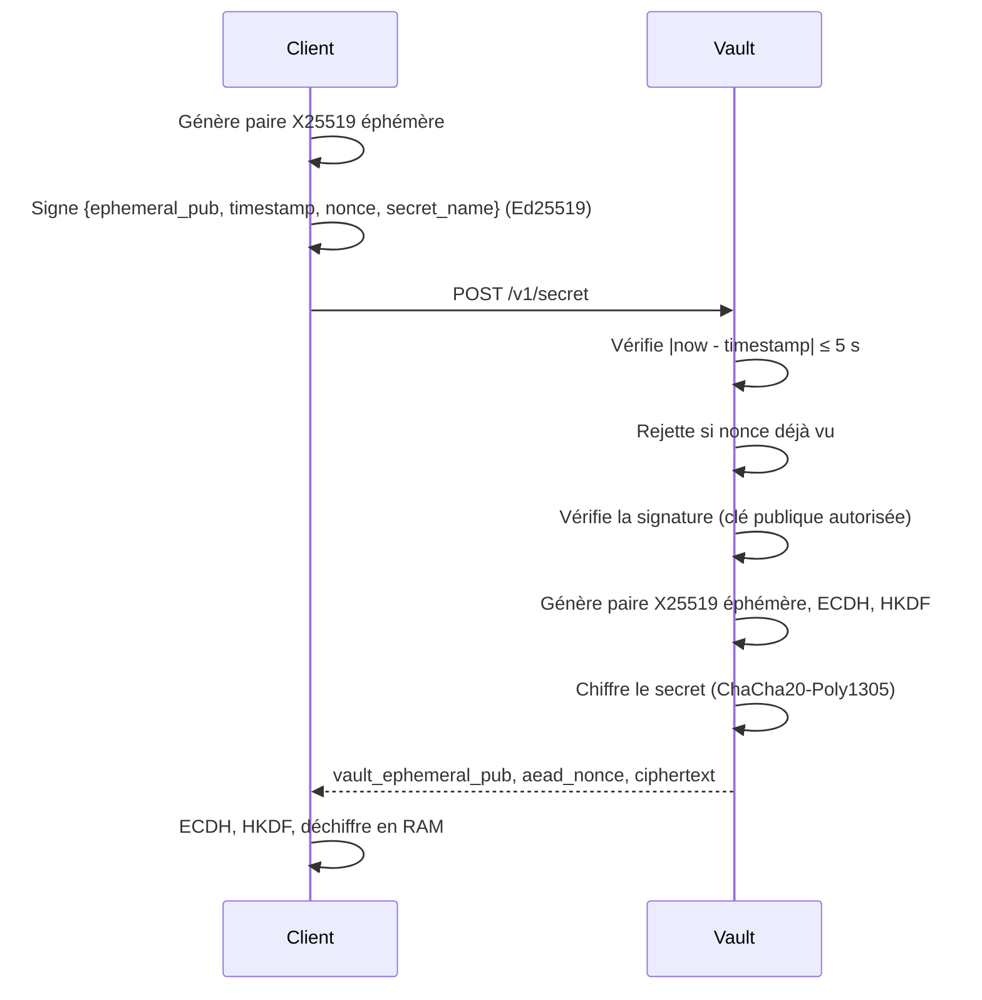

# Lab Zero-Trust Vault

Mini-Vault FastAPI : authentification Ed25519, anti-rejeu (timestamp + nonce), échange X25519 éphémère (ECIES) avec HKDF-SHA256 et ChaCha20-Poly1305.

## Architecture

## Protocole

## Cycle de vie des clés

| Clé | Type | Où / quand générée | Où elle vit | Transmise ? |
|---|---|---|---|---|
| Identité Ed25519 | **Privée** | Une fois, avant lancement (`setup.sh` / `openssl genpkey`, ou `standalone_debug.py` à chaque exécution) | Client uniquement (`/var/secrets/client_id.key`) | Jamais |
| Identité Ed25519 | **Publique** | En même temps que la privée | Vault (`/var/secrets/client_id.pub`) | Montée en secret Docker, pas via l'API |
| X25519 éphémère client | **Privée** | À chaque appel de `fetch_secret()`, avant l'envoi | RAM du client, abandonnée en fin d'appel | Jamais |
| X25519 éphémère client | **Publique** | En même temps que la privée | Envoyée au Vault (`ephemeral_pub`), incluse dans le payload signé | Oui |
| X25519 éphémère Vault | **Privée** | À chaque requête de `get_secret()`, après les contrôles timestamp, nonce, signature et existence du secret | RAM du Vault, abandonnée en fin de requête | Jamais |
| X25519 éphémère Vault | **Publique** | En même temps que la privée | Renvoyée au client (`vault_ephemeral_pub`) | Oui |
| Clé symétrique (ChaCha20) | Secrète (dérivée) | Calculée par chaque côté : ECDH (sa privée éphémère + la publique de l'autre) puis HKDF | RAM des deux côtés | Jamais |

Les clés éphémères n'existent qu'en RAM et ne sont jamais écrites sur disque. Si la clé privée d'identité fuit plus tard, les échanges passés restent indéchiffrables (forward secrecy).

## Utilisation

- Tout-en-un : `./setup.sh` (génère les clés, test local, puis Docker BuildKit)
- Local sans Docker : `python3 standalone_debug.py`
- Deux terminaux (breakpoints IDE) :
  - `CLIENT_PUB_KEY_PATH=./certs/client_id.pub uvicorn vault:app --host 127.0.0.1 --port 8000 --reload`
  - `CLIENT_PRIV_KEY_PATH=./certs/client_id.key VAULT_URL=http://127.0.0.1:8000/v1/secret python3 client.py`

Lab uniquement : secrets et nonces en mémoire, clés en `chmod 644`.
